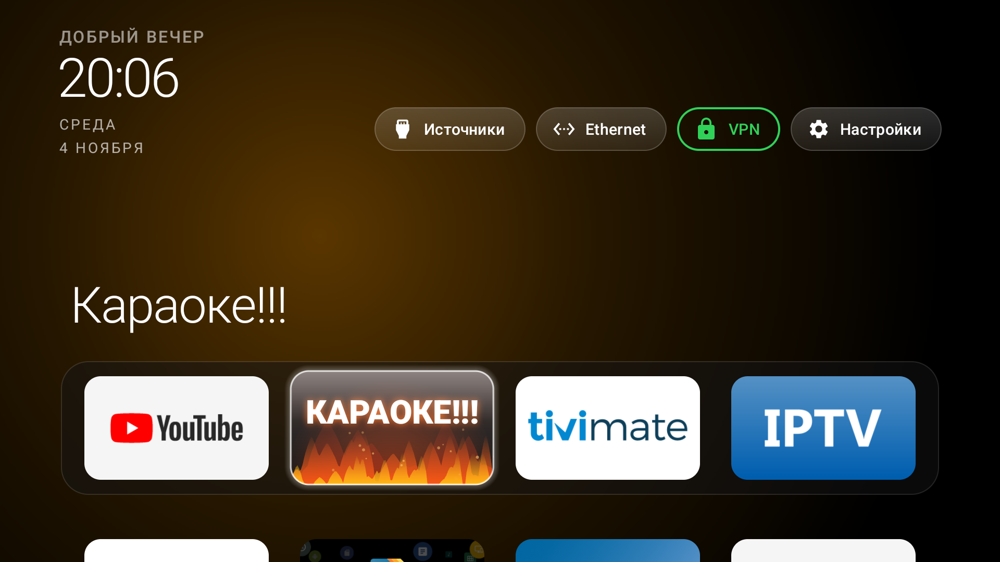
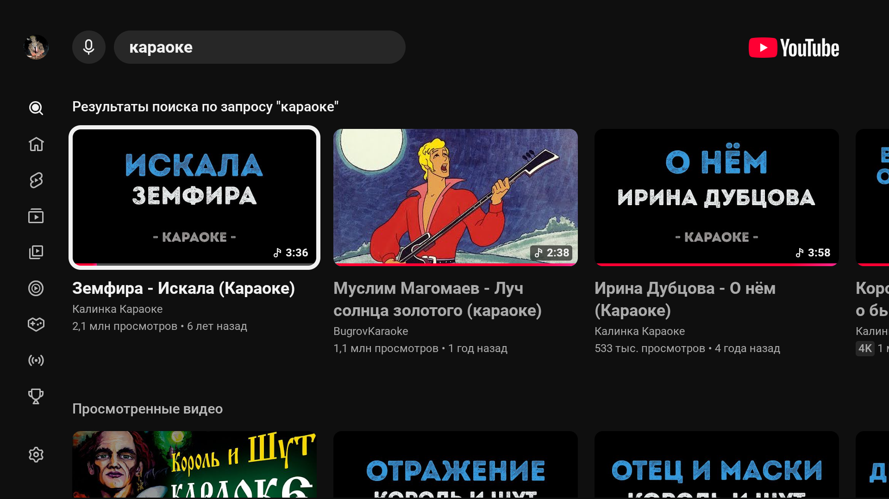
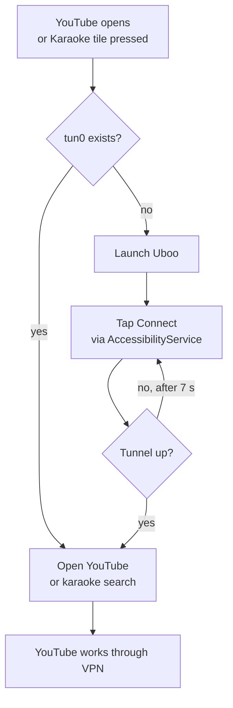

# YouTube VPN Gate + “Karaoke!!!” tile for Android TV

Android TV automation: when YouTube is opened, the app starts the **Uboo** VPN client
(`st.uboo.android.client`), taps **Connect**, waits for the tunnel and brings YouTube back with a
working connection. On the home screen there is a separate **“Karaoke!!!”** tile with animated fire:
one click turns the VPN on and opens YouTube karaoke search.

Built for a Philips 50PUS8057/60 (Android TV 14). **No root.** It uses a standard
`AccessibilityService`, not always-on VPN (the TV’s always-on does not start Uboo).

**Русская версия:** [README.md](README.md)

- Demo video: [`video/karaoke_tiktok.mp4`](video/karaoke_tiktok.mp4)
- Cover: [`video/cover.png`](video/cover.png)
- Prebuilt APKs: [`apk/`](apk/)
- Source: [`app/`](app/) · launcher patch: [`launcher/`](launcher/)



| “Karaoke!!!” screen | YouTube after connecting |
|---|---|
|  |  |

## How it works



1. The accessibility service watches for the `com.google.android.youtube.tv` window and checks for
   a `tun0` interface.
2. If the VPN is down, it opens Uboo, finds the “Подключить” (Connect) button — by text, or the
   largest clickable button in the right half of the screen — and taps it.
3. It waits for `tun0`, then restarts YouTube with `CLEAR_TASK`; otherwise YouTube stays on the
   “No connection” screen drawn before the tunnel came up.
4. The “Karaoke!!!” tile launches `KaraokeActivity` with fire, sends a request to the service, and
   the service opens `https://www.youtube.com/results?search_query=караоке`.

Uboo must be logged in and set to **“YouTube only”** mode. In that mode only YouTube goes through
the VPN; IPTV, TiviMate and Kinopoisk keep using the direct connection.

## Repository layout

```
app/            YouTube VPN Gate source (accessibility service + Karaoke screen)
  src/          plain Java, no third-party dependencies
  res/          screen, strings, service config
  build.ps1     APK build without Gradle (aapt2 + javac + d8 + apksigner)
  install.ps1   install + enable the service over adb
launcher/       optional fire tile for the CleanYourTV launcher
  FireBannerDrawable.java
  patches/      AppAdapter, MainActivity and config.xml changes
apk/            prebuilt APKs (debug-signed, sideload only)
video/          vertical TikTok video and cover
screenshots/    TV screenshots
docs/           algorithm, install, build, publishing
```

## Quick start

Requirements: ADB and network debugging enabled on the TV.

```powershell
# 1. Install the APK and enable the accessibility service
powershell -ExecutionPolicy Bypass -File app\install.ps1 -TvHost 192.168.1.50

# 2. In Uboo: log in, choose "YouTube only", connect once.
# 3. Disconnect the VPN in Uboo.
# 4. Open YouTube — Uboo should open by itself, tap Connect
#    and YouTube should come back in 2–4 seconds.
```

Logs:

```powershell
adb -s 192.168.1.50:5555 logcat -s VpnGate
```

Expected:

```
I VpnGate : window: com.google.android.youtube.tv
I VpnGate : YouTube in front, no VPN: opening st.uboo.android.client
I VpnGate : pressed connect (attempt 1)
I VpnGate : VPN is up
I VpnGate : YouTube opened
```

Full guide: [`docs/INSTALL.md`](docs/INSTALL.md).

### “Karaoke!!!” tile

`apk/CleanYourTV-Karaoke-3.2.apk` is a fork of
[CleanYourTV](https://github.com/Gathin23/cleanyourtv) where the `com.gathin.vpngate` tile is drawn
with animated fire. It is **optional**: without it YouTube→VPN still works, you just don’t get the
tile.

The launcher is debug-signed. If you already have CleanYourTV signed with a different key,
`adb install -r` will fail with `INSTALL_FAILED_UPDATE_INCOMPATIBLE` — rebuild it with your key
(see [`launcher/README.md`](launcher/README.md)) or uninstall the old version (you will lose the
Home role).

## Adapting to another VPN client

The Uboo package/activity, button labels and karaoke URL are constants in
[`GateAccessibilityService.java`](app/src/com/gathin/vpngate/GateAccessibilityService.java):

```java
private static final String PKG_VPN = "st.uboo.android.client";
private static final String ACT_VPN = "online.vpnnaruzhu.client.android.SingleActivity";
static final String KARAOKE_URL = "https://www.youtube.com/results?search_query=...";
```

For another client (v2rayTun, VanyaVPN, WireGuard) change the package/activity and the connect
button text. If the client has no “Connect” text, the fallback taps the largest clickable button on
the right. Rebuild the APK afterwards: [`docs/BUILD.md`](docs/BUILD.md).

The fire tile is enabled by the `fire_app` key in `config.xml` and the package in `dock_apps`.

## Limitations

- Written for the **Uboo + YouTube TV + Philips Android TV 14** combination. Other clients and
  firmware may behave differently.
- The accessibility service can see window content — that is required to tap a button in another
  app. Grant it manually or via adb, and revoke it when you no longer need it.
- Always-on VPN on this TV does not start Uboo, so the first YouTube launch after a full reboot
  takes 2–4 seconds longer.
- APKs are debug-signed and are not published to any store.
- A Uboo update may change the button text/layout; adjust the selector or use the large-button
  fallback.

## Security and privacy

- The manifest requests only `INTERNET`, used by `NetworkInterface.getNetworkInterfaces()` to see
  `tun0`. The app does not open network connections and does not send anything anywhere.
- No analytics, telemetry or third-party SDKs.
- The accessibility service has no internet access and reads only what is needed to find the
  Connect button.
- Disable ADB network debugging on the TV after setup, as recommended by the CleanYourTV docs.

## Build

Requirements: JDK 17+, Android SDK platform 34, build-tools 34.0.0.

```powershell
$env:JAVA_HOME   = "C:\Program Files\Java\jdk-21"
$env:ANDROID_HOME = "$env:LOCALAPPDATA\Android\Sdk"
powershell -ExecutionPolicy Bypass -File app\build.ps1
```

Result: `app\YouTube-VPN-Gate.apk`. Details: [`docs/BUILD.md`](docs/BUILD.md).

## License

MIT — see [`LICENSE`](LICENSE). The CleanYourTV launcher is MIT, © Gathin23 and contributors;
`FireBannerDrawable` and the patches are derivative work. YouTube and Uboo are trademarks of their
respective owners; this project is not affiliated with them.

## Disclaimer

This is a personal automation for a personal TV. Use it on your own device and follow the terms of
the services you use. The author is not responsible for account restrictions, third-party VPN
servers, or changes in the apps that break the automation.
