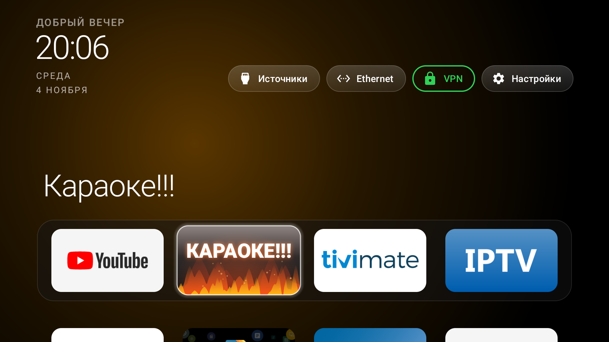
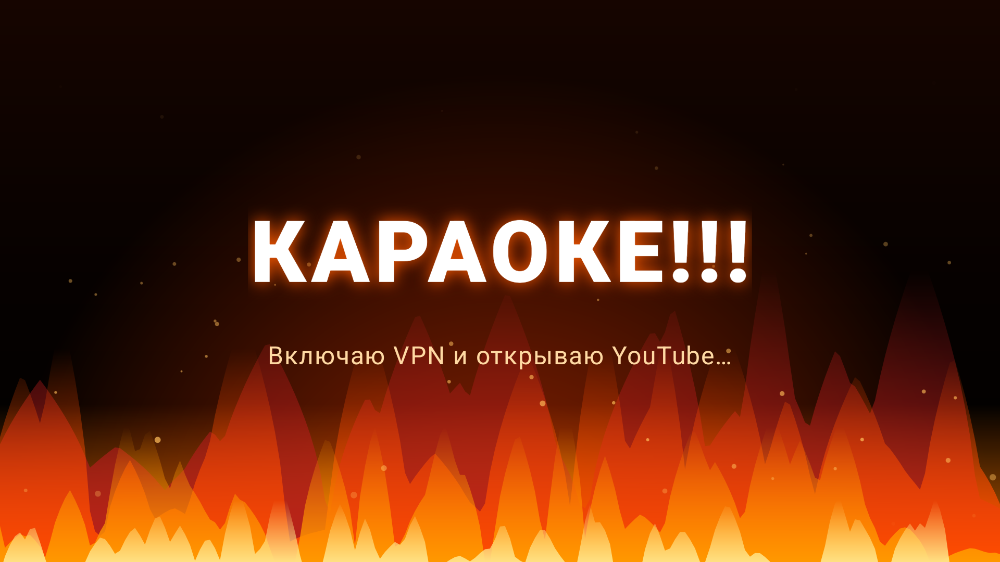
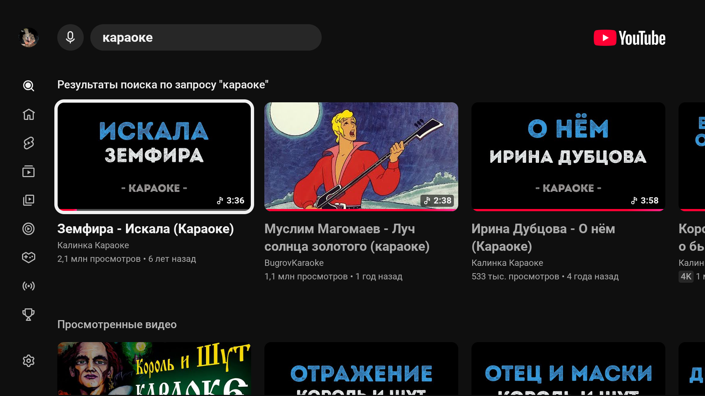
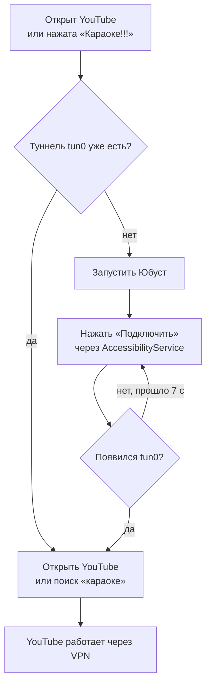

# YouTube VPN Gate + кнопка «Караоке!!!» для Android TV

**Русский** · [English](README.en.md)

Автоматика для Android TV: когда открывается YouTube, приложение само включает VPN в клиенте
**Юбуст** (`st.uboo.android.client`), подключает сервер и возвращает YouTube на экран уже рабочим.
На домашнем экране появляется отдельная плитка **«Караоке!!!»** с анимированным огнём: один клик —
VPN включается сам, YouTube открывается на поиске «караоке».

Проект вырос из задачи «YouTube на телевизоре не грузится, пока вручную не включишь VPN». Всё
работает **без root**, на штатном `AccessibilityService`, и не требует always-on VPN (на Philips
Android TV 14 он не запускает Юбуст).

- Видео «ДО / ПОСЛЕ»: [`video/karaoke_tiktok.mp4`](video/karaoke_tiktok.mp4)
- Обложка: [`video/cover.png`](video/cover.png)
- Готовые APK: [`apk/`](apk/)
- Исходники: [`app/`](app/) и патч лаунчера [`launcher/`](launcher/)



| Экран «Караоке!!!» | YouTube после подключения |
|---|---|
|  |  |

## Как это работает



1. Служба доступности ловит смену окна на `com.google.android.youtube.tv` и проверяет, есть ли
   сетевой интерфейс `tun0`.
2. Если VPN нет — открывает Юбуст, находит кнопку «Подключить» (по тексту, а если текст недоступен —
   самую большую кликабельную кнопку в правой половине экрана) и нажимает её.
3. Ждёт `tun0`, затем перезапускает YouTube с `CLEAR_TASK`: иначе остаётся экран «Нет подключения к
   сети», нарисованный до включения VPN.
4. Кнопка «Караоке!!!» запускает `KaraokeActivity` с огнём, та отправляет службе запрос, а служба
   после подключения открывает `https://www.youtube.com/results?search_query=караоке`.

Юбуст должен быть залогинен и стоять в режиме **«Только YouTube»** — тогда через VPN идёт только
YouTube, а IPTV, TiviMate и Кинопоиск ходят напрямую. Режим запоминается приложением.

## Что в репозитории

```
app/            исходники YouTube VPN Gate (служба доступности + экран «Караоке!!!»)
  src/          Java, без сторонних зависимостей
  res/          экран, строки, конфиг службы
  build.ps1     сборка APK без Gradle (aapt2 + javac + d8 + apksigner)
  install.ps1   установка и включение службы по adb
launcher/       опциональная плитка с огнём для лаунчера CleanYourTV
  FireBannerDrawable.java
  patches/      изменения AppAdapter, MainActivity и config.xml
apk/            собранные APK (debug-подпись, только для sideload)
video/          вертикальное видео для TikTok и обложка
screenshots/    скриншоты с телевизора
docs/           алгоритм, установка, сборка, публикация
```

## Быстрый старт

Нужны ADB и телевизор с включённой отладкой по сети.

```powershell
# 1. Поставить APK и включить службу доступности
powershell -ExecutionPolicy Bypass -File app\install.ps1 -TvHost 192.168.1.50

# 2. В Юбусте: войти, выбрать «Только YouTube», один раз подключиться.
# 3. Выключить VPN в Юбусте.
# 4. Открыть YouTube — Юбуст должен открыться сам, нажать «Подключить»,
#    и через 2–4 секунды YouTube вернётся на экран.
```

Логи:

```powershell
adb -s 192.168.1.50:5555 logcat -s VpnGate
```

Ожидаемо:

```
I VpnGate : window: com.google.android.youtube.tv
I VpnGate : YouTube in front, no VPN: opening st.uboo.android.client
I VpnGate : pressed connect (attempt 1)
I VpnGate : VPN is up
I VpnGate : YouTube opened
```

Подробная установка: [`docs/INSTALL.md`](docs/INSTALL.md).

### Плитка «Караоке!!!» с огнём

APK `apk/CleanYourTV-Karaoke-3.2.apk` — это форк лаунчера
[CleanYourTV](https://github.com/Gathin23/cleanyourtv) с плиткой `com.gathin.vpngate`, которая
рисуется анимированным огнём. Он **не обязателен** для работы автоматики: без него кнопки не будет,
но YouTube→VPN продолжит работать.

Важно: лаунчер подписан debug-ключом. Если у вас уже стоит CleanYourTV с другой подписью, обычный
`adb install -r` не пройдёт — нужно пересобрать лаунчер своим ключом (см.
[`launcher/README.md`](launcher/README.md)) или удалить старую версию (потеряется роль «Домой»).

## Настройка под свою VPN

Пакет и activity Юбуста, тексты кнопок и ссылка на караоке — константы в
[`GateAccessibilityService.java`](app/src/com/gathin/vpngate/GateAccessibilityService.java):

```java
private static final String PKG_VPN = "st.uboo.android.client";
private static final String ACT_VPN = "online.vpnnaruzhu.client.android.SingleActivity";
static final String KARAOKE_URL = "https://www.youtube.com/results?search_query=...";
```

Для другого клиента (v2rayTun, VanyaVPN, WireGuard) поменяйте пакет/activity и текст кнопки
подключения; если у клиента нет текста «Подключить», сработает поиск большой кнопки справа.
После изменений пересоберите APK: [`docs/BUILD.md`](docs/BUILD.md).

Плитка огня включается в лаунчере ключом `fire_app` в `config.xml` и пакетом в `dock_apps`.

## Ограничения

- Проект написан под конкретную связку **Юбуст + YouTube TV + Philips Android TV 14**. Другие
  клиенты и прошивки могут вести себя иначе.
- Служба доступности видит содержимое окон — это необходимо, чтобы нажать кнопку в чужом
  приложении. Разрешение выдаётся вручную/через adb и отзывается в настройках.
- Always-on VPN на этом телевизоре не запускает Юбуст, поэтому после полной перезагрузки первый
  запуск YouTube занимает на 2–4 секунды больше.
- APK подписаны debug-ключом и не публикуются в магазинах.
- Обновление Юбуста может изменить разметку/текст кнопки — тогда поправьте селектор или используйте
  резервный поиск большой кнопки.

## Безопасность и приватность

- В манифесте есть только `INTERNET` — он нужен `NetworkInterface.getNetworkInterfaces()`, чтобы
  увидеть `tun0`. Приложение не открывает сетевых соединений и ничего никуда не отправляет.
- Нет аналитики, телеметрии и сторонних SDK.
- Служба доступности не имеет доступа к интернету и не читает ваши данные дальше поиска кнопки.
- После настройки отключите отладку по ADB на телевизоре, как описано в документации CleanYourTV.

## Лицензия

Код проекта — MIT (см. [`LICENSE`](LICENSE)). Лаунчер CleanYourTV — MIT,
© Gathin23 и участники проекта; `FireBannerDrawable` и патчи — производная работа от него.
YouTube и Юбуст — товарные знаки соответствующих владельцев; проект с ними не связан.

## Дисклеймер

Проект не связан с Google, YouTube и сервисом Юбуст. Это личная автоматизация для собственного
телевизора: используйте её на своём устройстве и соблюдайте условия сервисов, которыми
пользуетесь. Автор не отвечает за блокировки аккаунта, работу сторонних VPN-серверов и изменения
в приложениях, которые ломают автоматику.

## Благодарности

- [Gathin23/cleanyourtv](https://github.com/Gathin23/cleanyourtv) — лаунчер и инфраструктура.
- Юбуст — клиент, который пришлось автоматизировать.
- Всем, кто делал screenrecord, ffmpeg и Android TV терпимым.
